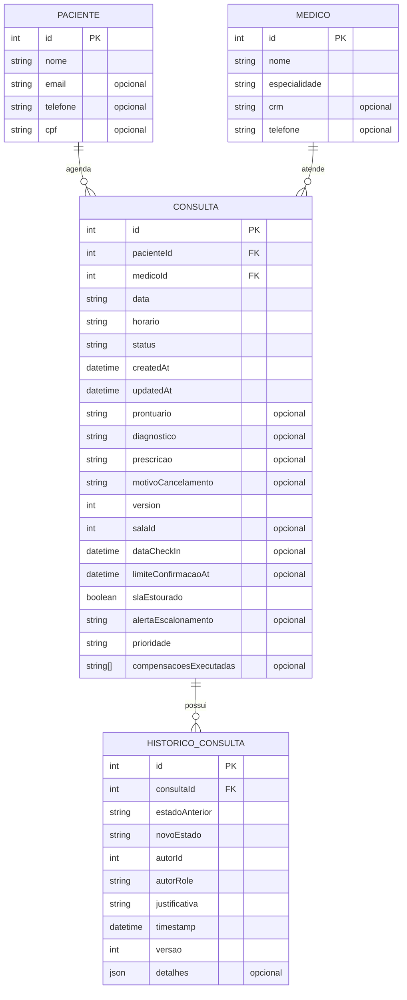
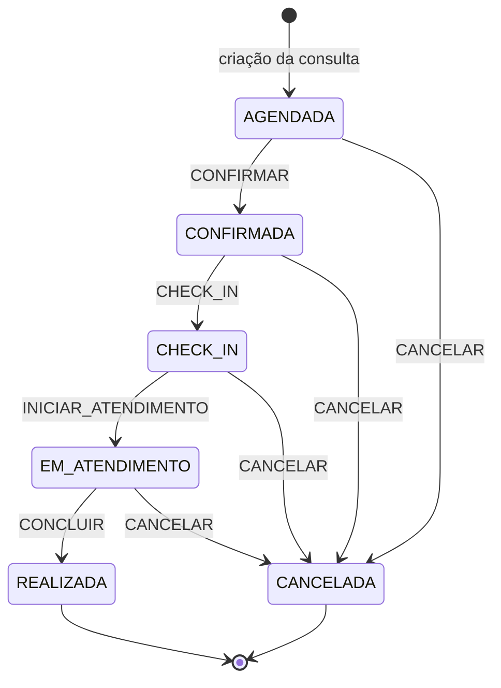

# Agenda Clínica

MVP acadêmico para gerenciamento de pacientes, médicos e agendamentos de consultas. O projeto é dividido em duas aplicações: uma interface web em Next.js e uma API em NestJS.

## Funcionalidades

- Cadastro, consulta, edição e exclusão de pacientes.
- Cadastro, consulta, edição e exclusão de médicos.
- Criação e gerenciamento de consultas.
- Controle do ciclo de vida da consulta por uma Máquina de Estados Finita (FSM).
- Registro de auditoria das transições de estado.
- Validações de perfil de usuário (RBAC), prontuário obrigatório e justificativa de cancelamento.
- Controle de concorrência por versão, políticas de SLA e ações compensatórias de rollback.

## Tecnologias

- **Frontend:** Next.js, React, TypeScript e Tailwind CSS.
- **Backend:** NestJS e TypeScript.
- **Persistência atual:** repositórios em memória com dados iniciais de demonstração.
- **Configuração adicional:** Prisma está presente no projeto do servidor.

## Estrutura do projeto

```text
.
├── ppw_client/   # Aplicação web Next.js
└── ppw_server/   # API NestJS e regras de negócio
```

## Diagrama Entidade-Relacionamento (DER)

O DER lógico abaixo foi elaborado a partir das entidades e dos repositórios presentes no código.



### Cardinalidades

- **Paciente 1 : N Consulta:** um paciente pode ter nenhuma ou várias consultas; cada consulta está associada a um único paciente.
- **Médico 1 : N Consulta:** um médico pode atender nenhuma ou várias consultas; cada consulta está associada a um único médico.
- **Consulta 1 : N Histórico da Consulta:** uma consulta pode possuir nenhum ou vários registros de auditoria; cada registro de histórico pertence a uma única consulta.

### Observações sobre o modelo

- `pacienteId`, `medicoId` e `consultaId` representam as chaves estrangeiras do modelo lógico.
- `salaId` aparece como atributo opcional de `Consulta`, mas o material analisado não contém uma entidade `Sala`.
- `autorId` e `autorRole` identificam o autor da ação no histórico. Não existe uma entidade `Usuario` no conjunto de entidades enviado; por isso, `autorId` não foi representado como chave estrangeira.
- Os estados possíveis de uma consulta são `AGENDADA`, `CONFIRMADA`, `CHECK_IN`, `EM_ATENDIMENTO`, `REALIZADA` e `CANCELADA`.
- O DER representa o modelo lógico das entidades do domínio. No código enviado, os repositórios ativos são implementados em memória; portanto, o diagrama não deve ser interpretado como prova de que essas tabelas já estejam criadas em um banco relacional.

## Diagrama simplificado de estados da consulta

O diagrama abaixo resume as transições permitidas pela máquina de estados implementada no backend.



### Regras importantes das transições

- **Confirmar:** permitido aos perfis `PACIENTE`, `RECEPCIONISTA` e `ADMIN`.
- **Check-in:** permitido aos perfis `RECEPCIONISTA` e `ADMIN`.
- **Iniciar atendimento:** permitido aos perfis `MEDICO` e `ADMIN`.
- **Concluir:** permitido aos perfis `MEDICO` e `ADMIN`; exige prontuário com pelo menos 5 caracteres e diagnóstico preenchido.
- **Cancelar:** exige justificativa com pelo menos 5 caracteres. O paciente só pode cancelar enquanto a consulta estiver `AGENDADA` ou `CONFIRMADA`; nos estados seguintes, o cancelamento deve ser realizado por recepção, médico ou administrador.
- `REALIZADA` e `CANCELADA` são estados finais, sem novas transições previstas.

Cada ação de transição executada pelo caso de uso específico gera um registro em `HISTORICO_CONSULTA`, contendo o estado anterior, o novo estado, o autor, a justificativa, a versão e detalhes complementares.

## Executar o ambiente localmente

### Pré-requisitos

- Node.js e npm instalados.
- Acesso ao terminal (PowerShell, Prompt de Comando ou terminal do VS Code).

### 1. Iniciar o backend

Abra um terminal na pasta do projeto e execute:

```bash
cd ppw_server
npm install
npm run start:dev
```

A API NestJS fica disponível em:

```text
http://localhost:8000
```

### 2. Iniciar o frontend

Abra **outro terminal** na pasta raiz do projeto e execute:

```bash
cd ppw_client
npm install
npm run dev
```

A aplicação web fica disponível em:

```text
http://localhost:3000
```

O frontend está configurado para consumir a API em `http://localhost:8000`. Por isso, mantenha o backend em execução enquanto utiliza a interface.

> **Nota sobre os comandos:** os arquivos `package.json` e os lockfiles não fizeram parte do material disponibilizado para esta documentação. Os comandos acima seguem os scripts convencionais de projetos NestJS (`start:dev`) e Next.js (`dev`). Confira os scripts existentes em cada `package.json` com `npm run` caso os nomes estejam diferentes no repositório.

### Banco de dados e Docker

No material analisado, não foram encontrados `Dockerfile`, `docker-compose.yml`, arquivo `schema.prisma` nem migrations do Prisma. Além disso, o módulo de repositórios registra implementações `InMemory` para pacientes, médicos, consultas e histórico.

Assim, a execução documentada acima não depende de subir um banco PostgreSQL via Docker. Os dados de demonstração são carregados pelos repositórios em memória e alterações feitas durante a execução não são persistidas após reiniciar o backend. A configuração Prisma existente indica uma integração prevista ou auxiliar, mas não é suficiente, por si só, para documentar uma inicialização de banco com segurança.

## Portas utilizadas

| Serviço | Endereço |
|---|---|
| Frontend (Next.js) | `http://localhost:3000` |
| Backend (NestJS) | `http://localhost:8000` |

## Observação

Este README descreve a estrutura e o comportamento identificados no código disponibilizado. Caso o projeto receba uma implementação de persistência relacional, recomenda-se atualizar o DER para refletir o `schema.prisma` ou o esquema físico efetivamente utilizado.
